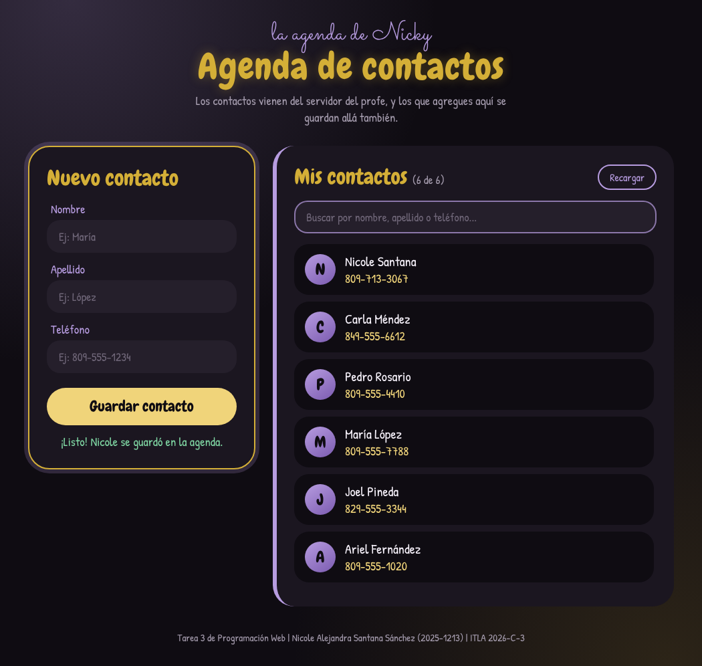

-----Agenda de contactos-----

Tarea 3 de Programación Web - ITLA
Nicole Alejandra Santana Sánchez - 2025-1213

Pues esta es mi agenda de contactos. Cuando abres la página, con fetch se cargan todos los contactos que están en el servidor del profe (raydelto.org/agenda.php), o sea que eso es el GET. ¿Y para agregar uno nuevo? Pues llenas el formulario con el nombre, el apellido y el teléfono, le das a guardar y el contacto se manda al servidor con POST, y ya te sale en la lista.

También le puse un buscador, porque son muchísimos contactos y así es más fácil encontrar a alguien. Y si se te olvida llenar algo o pones letras en el teléfono, no te deja guardar.

